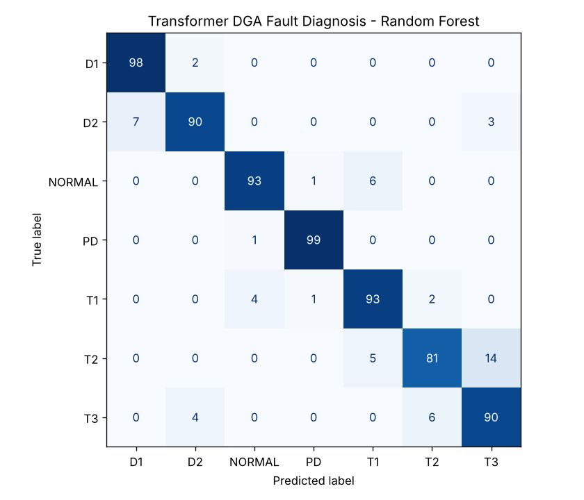
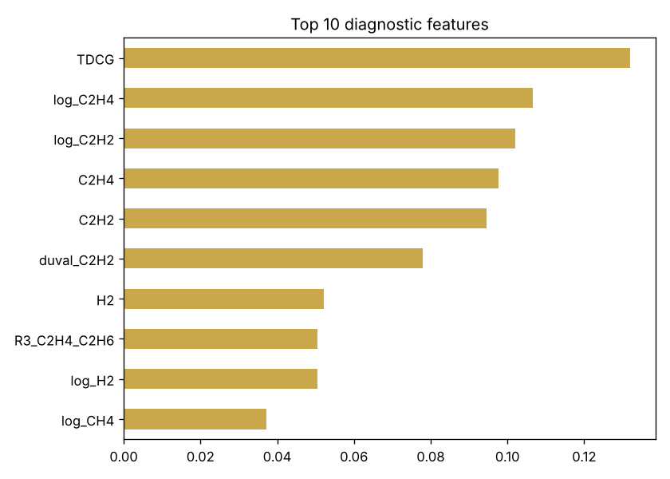

# Transformer Fault Diagnosis using Dissolved Gas Analysis (DGA) + ML

**Author:** Farrukh Hussain · Electrical Engineer (10+ yrs) · MEng ECE, University of Windsor

**Tech:** Python · scikit-learn · Pandas · Matplotlib

## Why it matters

Power transformers are the most expensive asset in a substation. When insulation starts to fail, the oil releases gases (H₂, CH₄, C₂H₆, C₂H₄, C₂H₂). Utilities test oil samples and interpret the gas ratios with IEC 60599 rules or the Duval Triangle — but those rules leave many samples *undetermined*.

## Approach

- Generated a 7-class DGA dataset (Normal, PD, D1, D2, T1, T2, T3) from typical IEC 60599 / IEEE C57.104 gas signatures with realistic log-normal lab scatter
- Engineered the same features a protection engineer uses: IEC key-gas ratios, Duval Triangle percentages, TDCG, log-concentrations
- Implemented the rule-based IEC ratio method as a baseline
- Trained a Random Forest and compared it against the IEC method; ranked the most diagnostic ratios

## Results

```text
IEC ratio method accuracy : 0.530
Random Forest accuracy    : 0.920

              precision    recall  f1-score   support

          D1       0.93      0.98      0.96       100
          D2       0.94      0.90      0.92       100
      NORMAL       0.95      0.93      0.94       100
          PD       0.98      0.99      0.99       100
          T1       0.89      0.93      0.91       100
          T2       0.91      0.81      0.86       100
          T3       0.84      0.90      0.87       100

    accuracy                           0.92       700
   macro avg       0.92      0.92      0.92       700
weighted avg       0.92      0.92      0.92       700

New oil sample diagnosis -> D2
```





## How to run

```bash
pip install -r requirements.txt
python dga_fault_diagnosis.py
```

> **Data note:** the project generates a realistic, engineering-based synthetic dataset so it runs anywhere with no download. The same pipeline can be pointed at real measurements (lab, SCADA, smart-meter or public Kaggle data).
