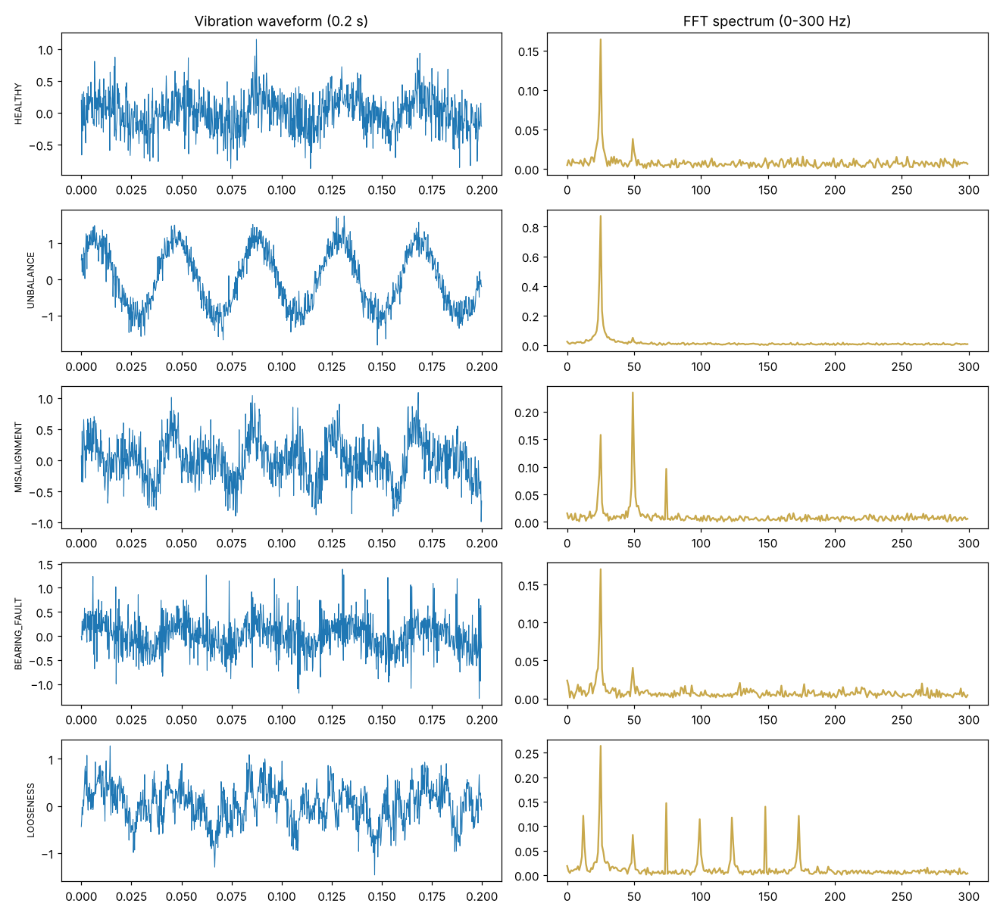

# Induction Motor Predictive Maintenance — Vibration Analysis + ML

**Author:** Farrukh Hussain · Electrical Engineer (10+ yrs) · MEng ECE, University of Windsor

**Tech:** Python · NumPy FFT · SciPy · scikit-learn

## Why it matters

On a continuous production line an unplanned motor failure stops everything. Each mechanical fault leaves a fingerprint in the vibration spectrum — unbalance at 1×, misalignment at 2×/3×, bearing defects at BPFO, looseness as many harmonics.

## Approach

- Simulated 1-second accelerometer captures (5 kHz) of a 1480 rpm, 4-pole motor for 5 conditions, including early-stage (low-severity) faults
- Extracted time-domain features (RMS, crest factor, kurtosis) and FFT band amplitudes at 0.5×, 1×, 2×, 3× and bearing-defect frequency — the same values a vibration analyst reads
- Trained a Gradient Boosting classifier for automatic fault diagnosis

## Results

```text
Fault classification accuracy: 0.971

               precision    recall  f1-score   support

BEARING_FAULT       0.98      0.95      0.97        63
      HEALTHY       0.88      0.98      0.93        62
    LOOSENESS       1.00      0.98      0.99        62
 MISALIGNMENT       1.00      1.00      1.00        63
    UNBALANCE       1.00      0.94      0.97        63

     accuracy                           0.97       313
    macro avg       0.97      0.97      0.97       313
 weighted avg       0.97      0.97      0.97       313

Live sensor reading diagnosis -> BEARING_FAULT
```



## How to run

```bash
pip install -r requirements.txt
python motor_vibration_pdm.py
```

> **Data note:** the project generates a realistic, engineering-based synthetic dataset so it runs anywhere with no download. The same pipeline can be pointed at real measurements (lab, SCADA, smart-meter or public Kaggle data).
