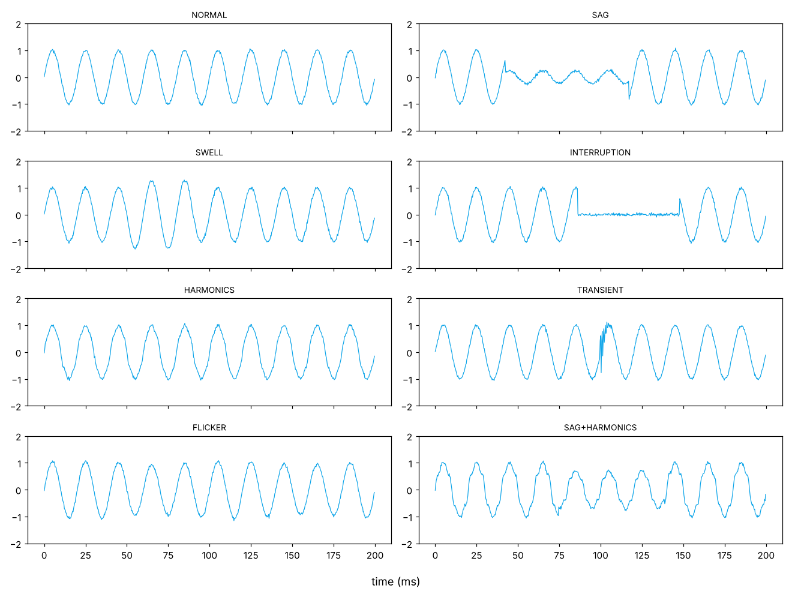
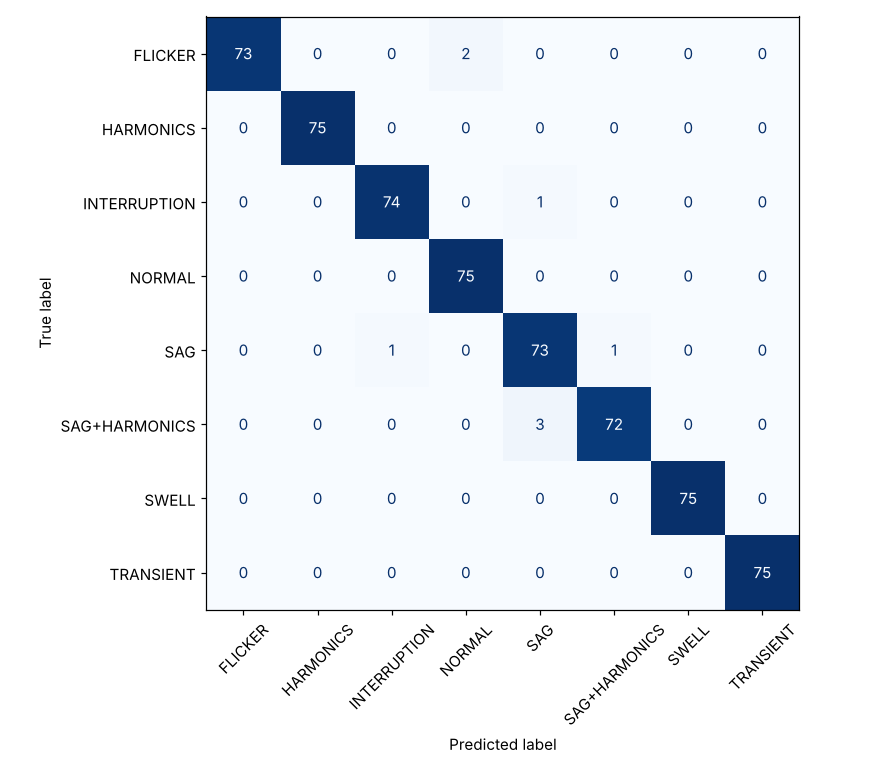

# Power Quality Disturbance Classification (IEEE 1159)

**Author:** Farrukh Hussain · Electrical Engineer (10+ yrs) · MEng ECE, University of Windsor

**Tech:** Python · NumPy · scikit-learn

## Why it matters

Voltage sags trip VFDs and PLCs, harmonics overheat transformers and neutral conductors, transients damage electronics. Power-quality analysers log thousands of events — classifying them by hand is slow.

## Approach

- Generated 50 Hz waveforms for 8 IEEE 1159 classes: normal, sag, swell, interruption, harmonics, transient, flicker, sag + harmonics
- Computed per-cycle RMS profile, THD (up to 15th harmonic), crest factor, high-frequency energy and modulation index
- Random Forest classifier with 5-fold cross-validation

## Results

```text
5-fold CV accuracy: 0.988
Hold-out accuracy : 0.987
```





## How to run

```bash
pip install -r requirements.txt
python power_quality_classifier.py
```

> **Data note:** the project generates a realistic, engineering-based synthetic dataset so it runs anywhere with no download. The same pipeline can be pointed at real measurements (lab, SCADA, smart-meter or public Kaggle data).
