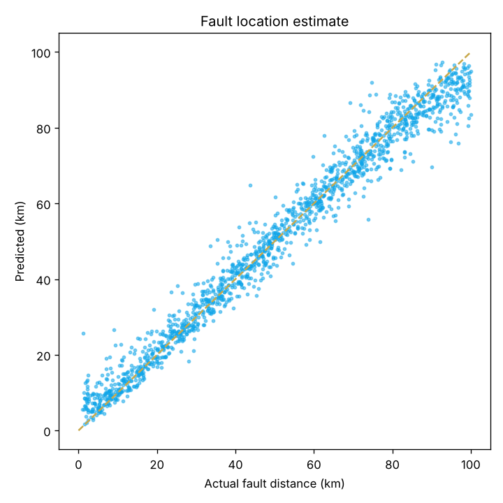

# Transmission Line Fault Classification & Location (132 kV)

**Author:** Farrukh Hussain · Electrical Engineer (10+ yrs) · MEng ECE, University of Windsor

**Tech:** Python · NumPy (complex phasors) · scikit-learn

## Why it matters

A distance relay must identify the faulted phases in milliseconds, and the line crew needs to know *where* along 100 km of line to look.

## Approach

- Modelled a 132 kV, 100 km line with source + line positive/zero-sequence impedances
- Computed relay-point phasors for all 10 fault types (AG…ABC) using symmetrical components — random fault distance and fault resistance (0–150 Ω), 4 % CT/VT error
- Random Forest classifier for fault type + Random Forest regressor for fault distance

## Results

```text
Fault-type classification accuracy: 0.999
Fault location MAE: 3.35 km on a 100 km line
```



## How to run

```bash
pip install -r requirements.txt
python line_fault_classifier.py
```

> **Data note:** the project generates a realistic, engineering-based synthetic dataset so it runs anywhere with no download. The same pipeline can be pointed at real measurements (lab, SCADA, smart-meter or public Kaggle data).
