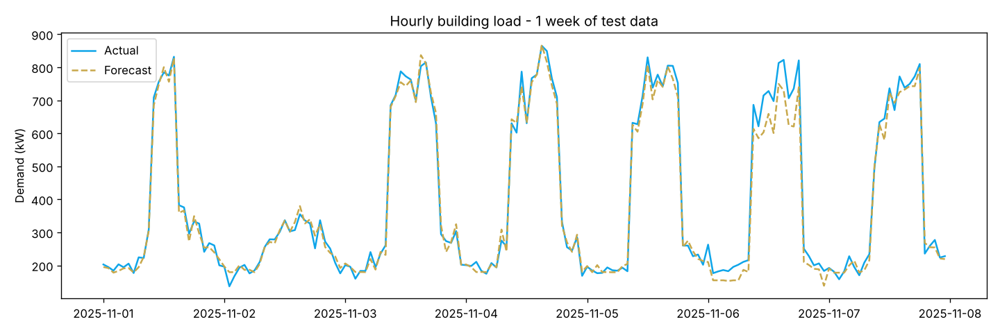

# Short-Term Electrical Load Forecasting for a Commercial Building

**Author:** Farrukh Hussain · Electrical Engineer (10+ yrs) · MEng ECE, University of Windsor

**Tech:** Python · Pandas · scikit-learn

## Why it matters

Facility managers need tomorrow's hourly demand to schedule generators, avoid maximum-demand (MDI) penalties and plan load shedding.

## Approach

- Simulated 2 years of hourly demand: base load + temperature-driven HVAC + occupancy + public holidays (Karachi climate)
- Features: hour (cyclic), weekday, month, cooling degrees, humidity, 24 h / 168 h lags, rolling mean
- Gradient Boosting vs. 'same hour last week' baseline, tested on the last 60 days

## Results

```text
Naive (last week) MAPE : 13.04 %
Gradient Boosting MAPE : 7.76 %
Forecast peak demand   : 868 kW  (actual 891 kW)
```



## How to run

```bash
pip install -r requirements.txt
python load_forecasting.py
```

> **Data note:** the project generates a realistic, engineering-based synthetic dataset so it runs anywhere with no download. The same pipeline can be pointed at real measurements (lab, SCADA, smart-meter or public Kaggle data).
