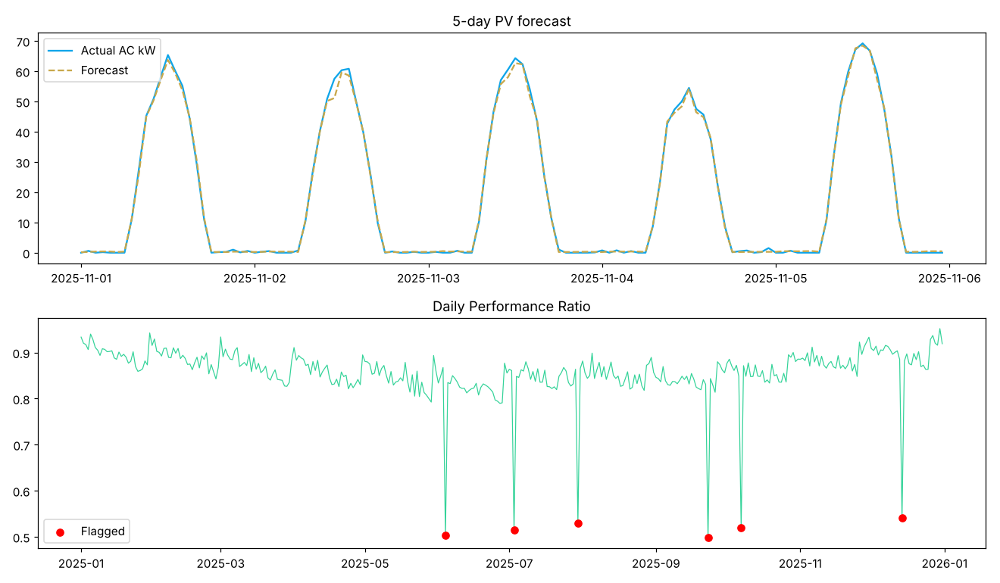

# Solar PV Power Forecasting & Performance Monitoring (100 kWp)

**Author:** Farrukh Hussain · Electrical Engineer (10+ yrs) · MEng ECE, University of Windsor

**Tech:** Python · Pandas · scikit-learn

## Why it matters

PV output depends on sun position, cloud and module temperature; dust and string/inverter faults silently reduce yield — a big issue on rooftops in Sindh.

## Approach

- Physics model: solar geometry for Karachi (24.9° N), cloud attenuation, NOCT module temperature, −0.4 %/°C power coefficient, soiling, inverter efficiency and clipping
- Random Forest forecasts AC power from weather-forecast inputs
- Daily Performance Ratio (PR) tracking with automatic low-PR fault-day detection

## Results

```text
Day-time MAE: 1.21 kW   R2: 0.984
Annual energy yield: 177 MWh  (specific yield 1766 kWh/kWp)
Low-PR days flagged : ['04-Jun', '03-Jul', '30-Jul', '23-Sep', '07-Oct', '14-Dec']
True fault days     : ['04-Jun', '03-Jul', '30-Jul', '23-Sep', '07-Oct', '14-Dec']
```



## How to run

```bash
pip install -r requirements.txt
python solar_pv_forecasting.py
```

> **Data note:** the project generates a realistic, engineering-based synthetic dataset so it runs anywhere with no download. The same pipeline can be pointed at real measurements (lab, SCADA, smart-meter or public Kaggle data).
