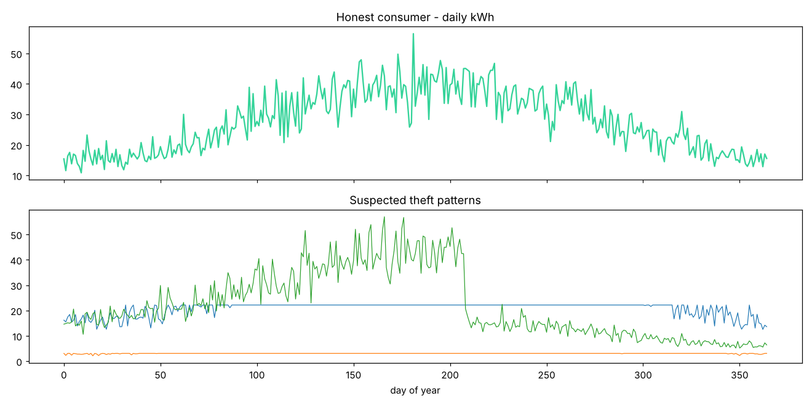

# Electricity Theft Detection from Smart-Meter Data

**Author:** Farrukh Hussain · Electrical Engineer (10+ yrs) · MEng ECE, University of Windsor

**Tech:** Python · scikit-learn · Pandas

## Why it matters

Non-technical losses (meter tampering, bypass, hooking) are a major problem for distribution companies in Pakistan. Field inspections are expensive, so they must be targeted.

## Approach

- Generated 6,000 one-year daily kWh profiles with seasonal AC load; 12 % include one of 4 theft patterns (bypass, tampering factor, zero days, capping)
- Engineered profile features: sudden drops, zero-day count, plateau ratio, summer/winter ratio, autocorrelation
- Supervised Gradient Boosting + unsupervised Isolation Forest (for feeders with no labels); ranked inspection list

## Results

```text
Supervised GBM   ROC-AUC: 0.957
Inspect top 12% -> hit rate 90.7% (random inspection: 12.5%)
Precision 0.99  Recall 0.87
Unsupervised IsolationForest ROC-AUC: 0.941
```



## How to run

```bash
pip install -r requirements.txt
python electricity_theft_detection.py
```

> **Data note:** the project generates a realistic, engineering-based synthetic dataset so it runs anywhere with no download. The same pipeline can be pointed at real measurements (lab, SCADA, smart-meter or public Kaggle data).
