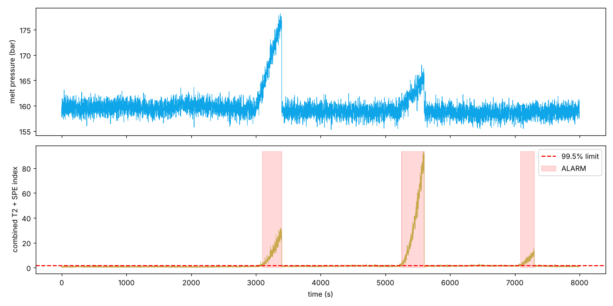

# SCADA / PLC Process Anomaly Detection — Film Extrusion Line

**Author:** Farrukh Hussain · Electrical Engineer (10+ yrs) · MEng ECE, University of Windsor

**Tech:** Python · scikit-learn (PCA, IsolationForest)

## Why it matters

Based on my 4.5 years at a continuous BOPP film plant: failures rarely show in one tag — they show as a *broken relationship* between tags (pressure rising while speed is constant = screen-pack blocking).

## Approach

- Simulated correlated PLC tags: extruder current, melt temperature, melt pressure, line speed, DC-drive current, film thickness
- Injected 3 realistic faults: screen-pack blockage, heater-band failure, DC-drive bearing wear
- PCA multivariate monitoring (Hotelling T² + SPE/Q) trained on normal data only, with PLC-style alarm debounce
- Per-tag contribution analysis to point the engineer at the root-cause tag; Isolation Forest as comparison

## Results

```text
PCA (T2+SPE) alarm: detected 78.5% of fault samples, false alarms 16 s out of 6900 s normal
IsolationForest flagged 44.5% of fault samples
  Screen-pack blockage   alarm after  99 s | root-cause tag -> melt_press_bar
  Heater band failure    alarm after  50 s | root-cause tag -> melt_temp_C
  DC drive bearing       alarm after  87 s | root-cause tag -> dc_drive_amp
```



## How to run

```bash
pip install -r requirements.txt
python scada_anomaly_detection.py
```

> **Data note:** the project generates a realistic, engineering-based synthetic dataset so it runs anywhere with no download. The same pipeline can be pointed at real measurements (lab, SCADA, smart-meter or public Kaggle data).
