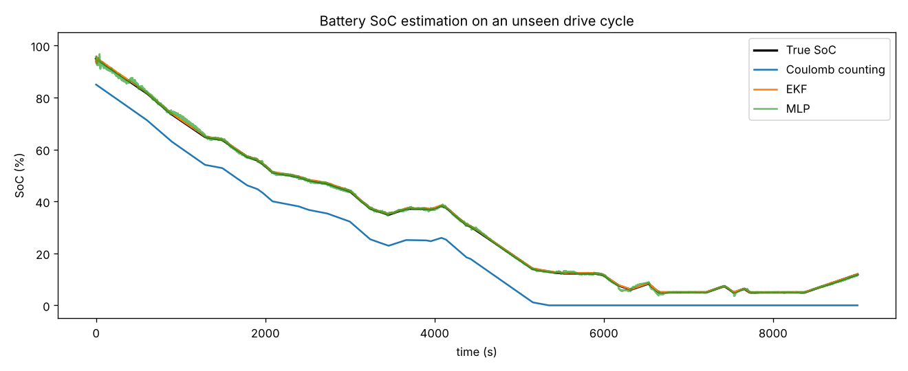

# Li-ion Battery State-of-Charge Estimation — Coulomb Counting vs EKF vs Neural Network

**Author:** Farrukh Hussain · Electrical Engineer (10+ yrs) · MEng ECE, University of Windsor

**Tech:** Python · NumPy · scikit-learn

## Why it matters

UPS systems, solar inverters and EVs need an accurate State-of-Charge. Simple current integration drifts; a real BMS fuses a battery model with voltage measurements.

## Approach

- 1-RC Thevenin equivalent-circuit model of an NMC cell with OCV curve, sensor noise and a 50 mA current-sensor offset
- Coulomb counting (with unknown initial SoC) as baseline
- Extended Kalman Filter written from scratch (state = SoC, RC voltage)
- MLP neural network trained on 20 drive cycles, tested on an unseen cycle

## Results

```text
Coulomb counting         RMSE = 10.25 % SoC
Extended Kalman Filter   RMSE = 0.21 % SoC
Neural network (MLP)     RMSE = 0.49 % SoC
```



## How to run

```bash
pip install -r requirements.txt
python battery_soc_estimation.py
```

> **Data note:** the project generates a realistic, engineering-based synthetic dataset so it runs anywhere with no download. The same pipeline can be pointed at real measurements (lab, SCADA, smart-meter or public Kaggle data).
